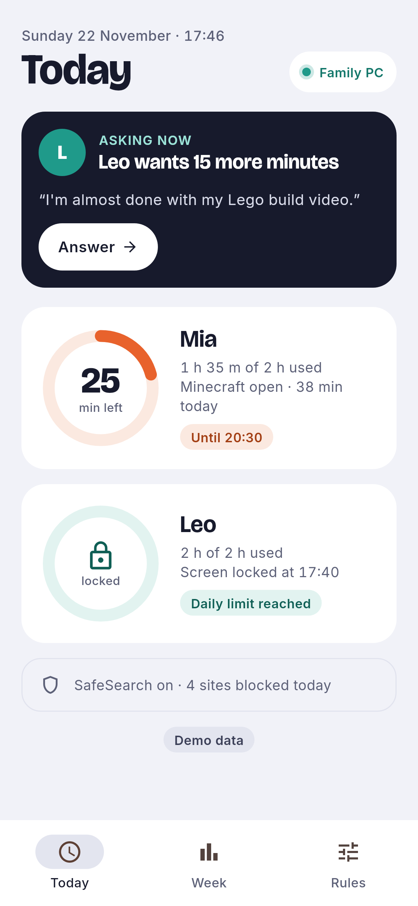
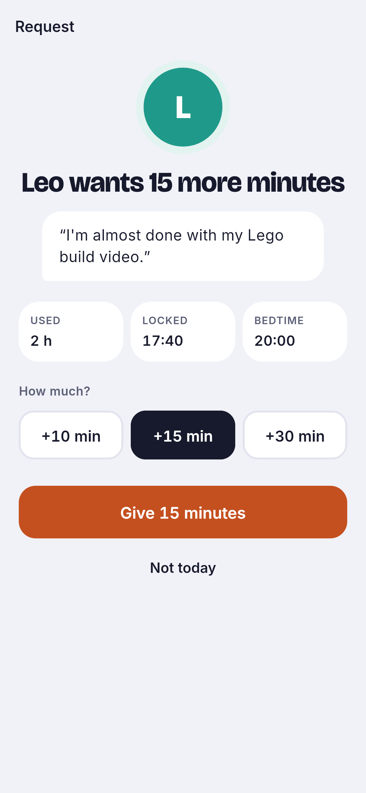
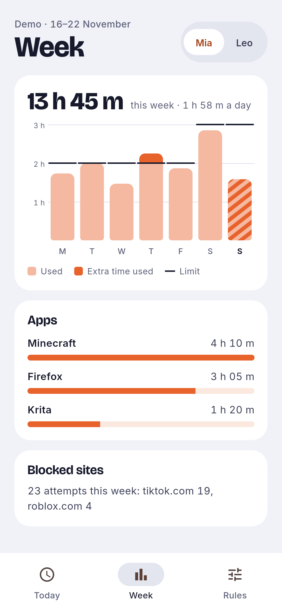
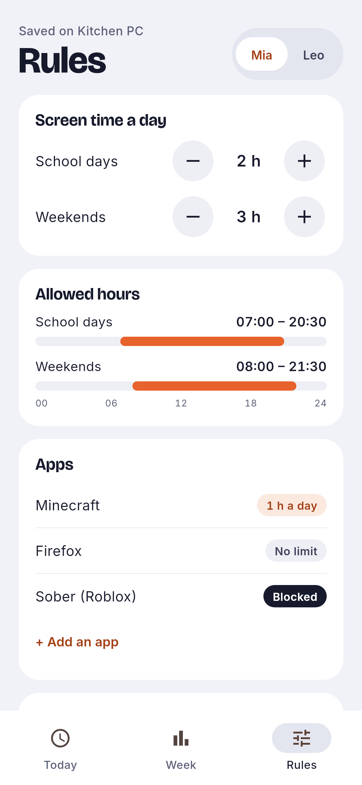

<p align="center">
  
</p>

<h1 align="center">Hearth</h1>

<p align="center">
  Parental controls for Linux family PCs, with a parent app for your phone.
</p>

<p align="center">
  <a href="https://github.com/fagostini/hearth/releases/latest"></a>
  <a href="LICENSE"></a>
  
  
</p>

<p align="center">
  
  
  
  
</p>

## Features

- **Screen time:** a daily limit and allowed hours per child, counted only while the child is actually using the PC (idle time doesn't count). When time runs out the session locks, then logs out.
- **Per-app limits:** minutes per day for single apps (native, Flatpak and Snap), or block an app entirely.
- **Web filtering:** SafeSearch and blocked sites per child, through a built-in DNS resolver that applies only to that child's account.
- **Asking for more time:** the child asks from the PC; the parent gets a notification on their phone and answers with one tap.
- **Parent app (Android):** today's usage, a 7-day history, rules and requests, live from the PC.

> [!NOTE]
> Early release (0.1). Tested on Ubuntu 24.04 with KDE Plasma and GNOME, and with an Android phone.

## Install

Download the `.deb` (Ubuntu/Debian), `.rpm` (Fedora) and the parent app `.apk` from the [latest release](https://github.com/fagostini/hearth/releases/latest). Arch users can build from `packaging/aur/PKGBUILD`, or build everything from source (see [Build](#build)). Then:

```sh
sudo apt install ./hearth_0.1.2-1_amd64.deb     # or: sudo dnf install ./hearth-0.1.2-1.x86_64.rpm
sudo hearthd setup
```

`hearthd setup` asks which accounts belong to children (or creates them), sets their first rules, turns on web filtering, starts Hearth and shows a QR code for the parent app. Install the `.apk` on your phone and scan the code.

> [!IMPORTANT]
> Children's accounts must not be administrators.

## How it works

| Part | Runs as | Does |
|---|---|---|
| `hearthd` | root, systemd service | Rules, time accounting, enforcement through logind, per-app limits through systemd cgroups, nftables rules for DNS |
| `hearth-dns` | systemd `DynamicUser` | One DNS port per child: SafeSearch, blocklists |
| `hearth-agent` | each child's session | Notifications ("5 minutes left"), "ask for more time" |
| Parent app | phone (Flutter + Rust) | Talks to `hearthd` end to end encrypted |

The PC and the phone pair once with a QR code. After that they exchange messages through an [ntfy](https://ntfy.sh) relay (ntfy.sh by default, or your own). Messages are encrypted end to end (X25519 + XChaCha20-Poly1305), so the relay sees only sealed envelopes, never names, times or requests. Notifications reach a closed app through [UnifiedPush](https://unifiedpush.org) (for example the ntfy app); the app also checks hourly in the background, and you can pull down on Today to refresh.

Each child needs their own Linux account, without admin rights.

## Build

Requirements: Rust (edition 2024), and for the app Flutter and the Android SDK.

```sh
cargo build --release -p hearthd -p hearth-agent
cargo deb -p hearthd --no-build             # .deb  (cargo install cargo-deb)
cargo generate-rpm -p crates/hearthd        # .rpm  (cargo install cargo-generate-rpm)
cd app && flutter build apk                 # parent app
```

`data/` has the systemd units, D-Bus policy, autostart entry and an example `hearthd.toml`.

## License

[GPL-3.0](LICENSE).
